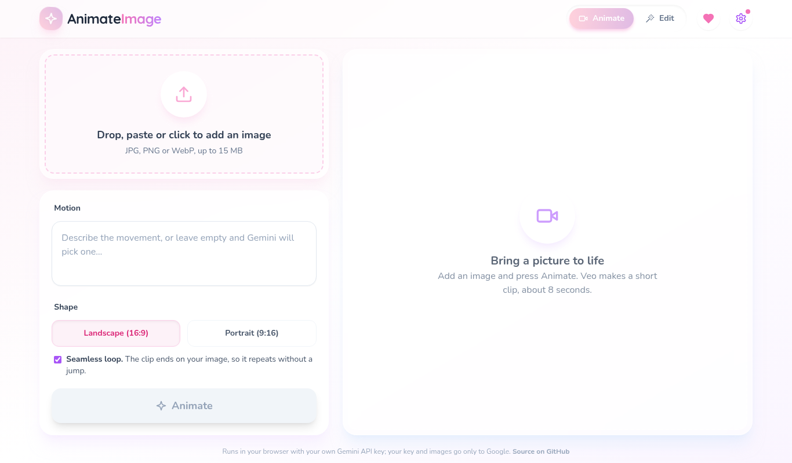

# AnimateImage

Turn a photo into a short, seamlessly looping video, or edit it with a sentence,
using your own Gemini API key. It runs entirely in your browser: there is no
AnimateImage server, and your key and images go only to Google.

**Try it: [voidall.com/animateimage](https://www.voidall.com/animateimage/)**



## What it does

- **Animate:** add an image and press **Animate**. Google's Veo makes a clip of
  about 8 seconds, landscape (16:9) or portrait (9:16). Describe the motion, or
  leave it empty and Gemini looks at the picture and picks one.
- **Seamless loop** (on by default): your image is used as both the first and
  the last frame, so the clip ends where it started and repeats without a jump.
- **Edit:** describe a change ("add a neon glow", "remove the background") and
  Gemini's image model makes it.
- Drop, paste (Ctrl+V) or pick an image, up to 15 MB. Download the result.

## Your API key

1. Create a key in [Google AI Studio](https://aistudio.google.com/app/apikey).
2. Video (Veo) needs **billing turned on** for the key's Google Cloud project.
   Everything you make is billed to that project at Google's prices; check
   [Gemini API pricing](https://ai.google.dev/gemini-api/docs/pricing) first.
3. Open Settings (the gear) and paste the key. The app checks it with Google
   before saving.

Where the key is kept: in this browser only. With **Remember on this device**
it stays in `localStorage`; without it, it's in `sessionStorage` and is gone
when you close the tab. **Forget key** removes it. Don't remember it on a
shared computer.

The app asks Google which models your key can use and picks the best one it
knows (Veo 3.1, then older Veo; the newest Gemini Flash and Flash Image), so
renamed or retired preview models don't break it.

## Run it yourself

```bash
npm install
npm run dev        # http://localhost:3001/animateimage/
npm run build      # static site in dist/
npm run deploy     # build and publish dist/ to the gh-pages branch
```

Plain React + Vite + the `@google/genai` SDK. The key is never built into the
site; each person enters their own.

## License

MIT. If it's useful to you, [sponsoring on GitHub](https://github.com/sponsors/jebin2) is welcome.
